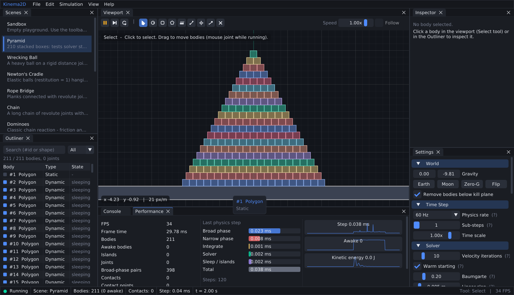
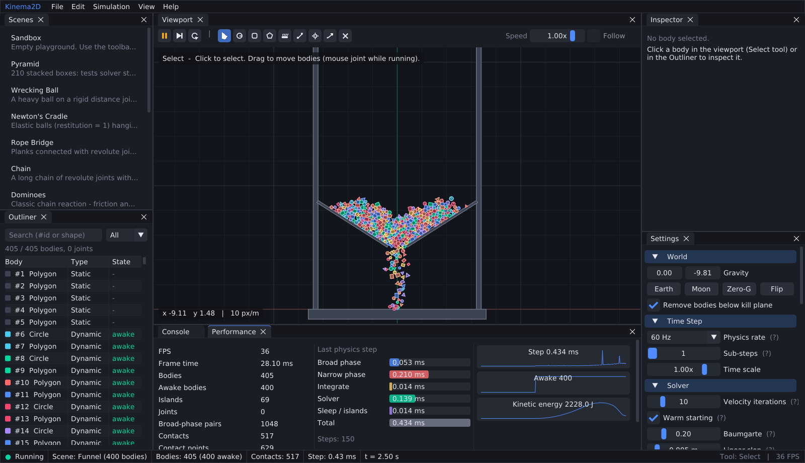
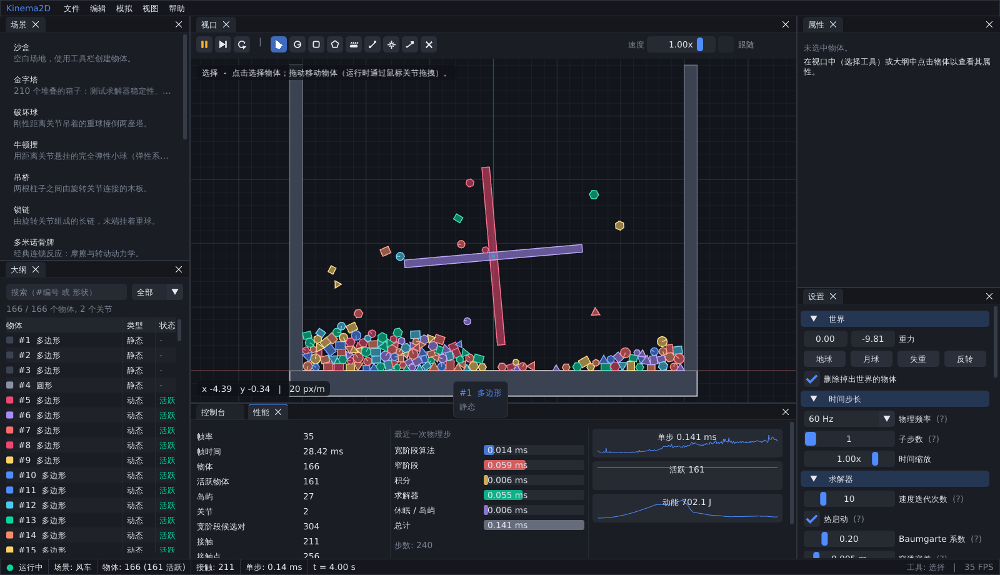
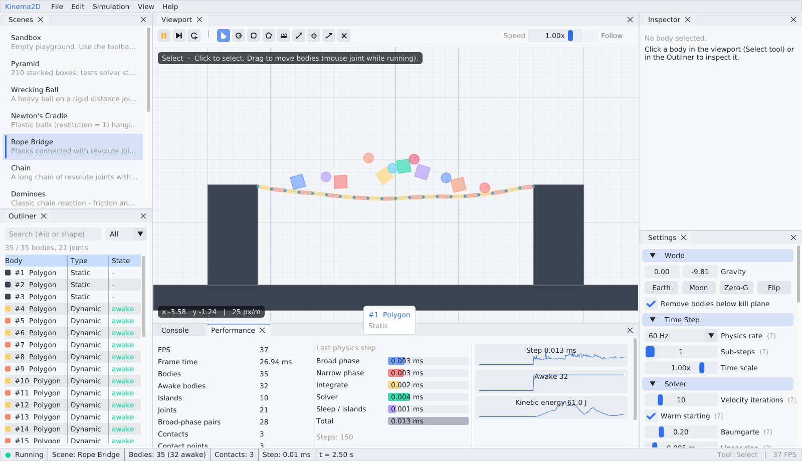

<div align="center">

# Kinema2D

**从零实现的 C++ 2D 刚体物理引擎 + 专业级桌面可视化客户端**

一个为 **学习** 而设计的完整项目：引擎核心不依赖任何第三方库，每个算法都有中文注释与配套文档；
客户端采用 Unity / Unreal 风格的可停靠编辑器界面，所有物理参数都能实时调节、实时观察。

   



</div>

---

## ✨ 功能一览

### 物理引擎（`engine/`，纯 C++17，零依赖）

| 模块 | 实现 |
| --- | --- |
| 形状 | 圆、凸多边形（自动求凸包、质心、转动惯量） |
| 宽阶段 | 排序扫掠（Sweep and Prune，自适应选轴）/ 暴力枚举，可运行时切换对比 |
| 窄阶段 | 分离轴定理（SAT）+ Sutherland–Hodgman 裁剪生成 1~2 点接触流形 |
| 求解器 | 顺序冲量法（Sequential Impulses）、热启动（Warm Starting）、**2×2 块求解器**、Baumgarte 位置修正 |
| 摩擦 / 弹性 | 库仑摩擦锥、恢复系数、反弹阈值 |
| 关节 | 距离关节（刚性杆 / 软弹簧）、旋转关节（带马达）、鼠标关节（软约束） |
| 休眠 | 基于并查集（Union-Find）的岛屿休眠 |
| 查询 | 点查询、AABB 查询、射线检测、爆炸冲量 |
| 其他 | 碰撞过滤（category / mask）、运动学物体、固定时间步、子步、性能统计 |

### 桌面客户端（`app/`，GLFW + OpenGL 3.3 + Dear ImGui）

- 🪟 **可停靠多面板编辑器**：视口 / 场景 / 大纲 / 属性 / 设置 / 性能 / 控制台，布局自动保存
- 🎮 **9 种交互工具**：选择拖拽、生成圆 / 方块 / 多边形（拖动 = 弹弓发射 + 抛物线预测）、静态方块、关节、爆炸、射线、删除
- 🔍 **属性面板**：实时编辑位置、速度、形状、材质、阻尼、碰撞过滤、关节马达……
- 📊 **性能面板**：各物理阶段耗时条形图、计数器、步长 / 活跃物体 / 动能历史曲线
- 🧪 **调试绘制**：AABB、接触点、法线、冲量、质心、速度向量、休眠着色
- 🎬 **13 个示例场景**：金字塔、破坏球、牛顿摆、吊桥、锁链、多米诺、漏斗（400 物体）、风车、小车、材质对比、软体、搅拌机……
- 🌐 **中英文界面一键切换**，🌗 **深色 / 浅色主题**，🖥️ 高 DPI 支持，4× MSAA 抗锯齿
- 💾 场景保存 / 读取（人类可读的 `.kscene` 文本格式）、PNG 截图

<table>
<tr>
<td><p align="center">漏斗：400 个物体的宽阶段压力测试</p></td>
<td><p align="center">中文界面 + 风车（马达关节 + 碰撞过滤）</p></td>
</tr>
<tr>
<td colspan="2"><p align="center">浅色主题：吊桥（旋转关节链）</p></td>
</tr>
</table>

---

## 🚀 快速开始

### 环境要求

- 支持 C++17 的编译器：**MSVC 2019+ / GCC 9+ / Clang 10+ / Apple Clang 12+**
- **CMake 3.20+**
- 支持 **OpenGL 3.3** 的显卡驱动
- 首次配置需要联网（CMake 会自动下载 GLFW、Dear ImGui、GoogleTest）

<details>
<summary><b>Linux 额外依赖</b>（Ubuntu / Debian）</summary>

```bash
sudo apt install build-essential cmake ninja-build libgl-dev libxrandr-dev libxinerama-dev libxcursor-dev libxi-dev libxkbcommon-dev
```
</details>

### 构建与运行

```bash
git clone <你的仓库地址> kinema2d
cd kinema2d
cmake -S . -B build -DCMAKE_BUILD_TYPE=Release
cmake --build build --config Release -j
```

运行客户端：

```bash
./build/bin/Kinema2D                  # Linux / macOS
build\bin\Release\Kinema2D.exe        # Windows (Visual Studio 生成器)
```

> 💡 **Windows + Visual Studio**：直接用 VS 打开项目文件夹（"打开本地文件夹"），VS 会识别 `CMakeLists.txt` 与 `CMakePresets.json`，选择 `Kinema2D.exe` 作为启动项即可 F5 调试。
>
> 💡 **VS Code**：安装 *CMake Tools* 扩展，选择预设 `release` 或 `debug` 即可。

### 命令行参数

```bash
Kinema2D --scene car            # 启动时加载指定场景（--list-scenes 查看全部）
Kinema2D --lang zh              # 中文界面
Kinema2D --light                # 浅色主题
Kinema2D --scene funnel --screenshot out.png --frames 200   # 运行 200 帧后截图并退出
```

### 运行测试与基准

```bash
ctest --test-dir build --output-on-failure      # 41 个单元 / 集成测试
./build/bin/kinema_bench                        # 性能基准
./build/bin/kinema_bench funnel --steps 1000    # 指定场景
```

---

## 🎮 操作说明

| 输入 | 功能 |
| --- | --- |
| `Space` | 运行 / 暂停 |
| `N` 或 `→` | 单步前进一帧（暂停时观察细节非常有用） |
| `R` | 重置场景 |
| `1` ~ `9` | 切换工具：选择、圆、方块、多边形、静态、关节、爆炸、射线、删除 |
| 鼠标左键 | 使用当前工具；选择工具下在空白处拖动可平移 |
| 鼠标右键 / 中键拖动 | 平移相机 |
| 滚轮 | 以光标为中心缩放 |
| `F` | 相机跟随选中物体（试试小车场景！） |
| `H` | 重置相机 |
| `Del` | 删除选中物体 |
| `Ctrl+S` / `Ctrl+O` | 保存 / 打开场景 |
| `F12` | 保存截图 |

---

## 🏗️ 项目结构

```
kinema2d/
├── engine/                     # ① 物理引擎核心库（只依赖标准库）
│   ├── include/kinema/
│   │   ├── math/               #   Vec2 / Rot / Transform / Mat22 / AABB
│   │   ├── collision/          #   Shape、窄阶段 Collision、宽阶段 BroadPhase
│   │   ├── dynamics/           #   Body、Contact + ContactSolver、World
│   │   ├── joints/             #   Distance / Revolute / Mouse 关节
│   │   └── Kinema.h            #   总头文件
│   └── src/
├── scene/                      # ② 场景库：13 个示例场景 + .kscene 序列化
├── app/                        # ③ 桌面客户端
│   └── src/
│       ├── core/               #   Application：窗口、主循环
│       ├── render/             #   自写 GL 加载器、Shader、Framebuffer、批量 Renderer2D、Camera2D
│       ├── editor/             #   Editor、Simulation(固定步长)、DebugDraw、Theme
│       │   └── panels/         #   各个可停靠面板
│       └── util/               #   日志、i18n、PNG 写入
├── tests/                      # ④ GoogleTest 单元 + 集成测试
├── tools/benchmark/            # ⑤ 命令行性能基准
├── examples/hello.kscene       #   手写的示例场景文件
├── docs/                       # 📚 架构、物理原理、学习路线
├── cmake/                      #   依赖下载、编译警告配置
└── .github/workflows/ci.yml    #   三平台持续集成
```

依赖方向严格单向：`app → scene → engine`。引擎不知道"界面"和"渲染"的存在，因此可以被测试、基准程序、甚至别的游戏直接复用。

---

## 📚 学习路线

这个项目最适合按下面的顺序阅读（每一步都可以在客户端里看到效果）：

1. **数学基础** —— `engine/include/kinema/math/Math.h`：2D 叉积的三种形式是理解刚体运动的钥匙。
2. **形状与质量** —— `collision/Shape.cpp`：凸包、质心、转动惯量（平行轴定理）。
3. **积分** —— `dynamics/World.cpp` 中的 `Solve()`：半隐式欧拉。打开 *Settings → Gravity* 试试月球重力。
4. **碰撞检测** —— `collision/Collision.cpp`：SAT + 裁剪。打开 *Debug Draw → Contact points / normals*。
5. **宽阶段** —— `collision/BroadPhase.cpp`：在漏斗场景切换两种算法，看性能面板。
6. **约束求解** —— `dynamics/Contact.cpp`：顺序冲量 + 热启动 + 块求解器。在金字塔场景关闭 *Warm starting* 对比。
7. **关节** —— `joints/Joint.cpp`：刚性约束与软约束（弹簧）的统一框架。
8. **休眠** —— `World::UpdateSleep()`：并查集构建岛屿。打开 *Sleep tint* 观察。
9. **客户端架构** —— `app/src/`：固定时间步、离屏渲染、批处理、即时模式 GUI。

详细内容见：

- 📐 [docs/PHYSICS.md](docs/PHYSICS.md) —— 物理与算法原理（含公式推导，对应到具体代码）
- 🧱 [docs/ARCHITECTURE.md](docs/ARCHITECTURE.md) —— 软件架构与设计决策
- 🗺️ [docs/LEARNING_PATH.md](docs/LEARNING_PATH.md) —— 分阶段学习计划 + 进阶练习题

---

## 📈 性能参考

`kinema_bench`（Release，单线程，60 Hz，每步平均耗时）：

| 场景 | 物体 | 宽阶段 | 总耗时 | 宽阶段耗时 |
| --- | ---: | --- | ---: | ---: |
| Pyramid | 211 | Brute Force | 0.059 ms | 0.024 ms |
| Pyramid | 211 | Sweep and Prune | 0.040 ms | 0.007 ms |
| Funnel | 405 | Brute Force | 0.378 ms | 0.174 ms |
| Funnel | 405 | Sweep and Prune | 0.261 ms | 0.051 ms |

（数据来自 Linux 云服务器，你的机器上数值会不同，但两种算法的相对差距是一致的。）

---

## 🧰 技术栈

| 组件 | 用途 | 引入方式 |
| --- | --- | --- |
| [GLFW 3.4](https://www.glfw.org/) | 跨平台窗口与输入 | CMake FetchContent |
| [Dear ImGui 1.91.9b (docking)](https://github.com/ocornut/imgui) | 即时模式 GUI | CMake FetchContent |
| [GoogleTest 1.15.2](https://github.com/google/googletest) | 单元测试 | CMake FetchContent |
| OpenGL 3.3 Core | 渲染 | 自写函数加载器（`app/src/render/GL.h`） |

## 🙏 参考资料

- Erin Catto, *Box2D* 与 GDC 系列演讲（Sequential Impulses, Soft Constraints, Contact Manifolds）
- Glenn Fiedler, *Fix Your Timestep!*
- Christer Ericson, *Real-Time Collision Detection*
- Ian Millington, *Game Physics Engine Development*

## 📄 License

[MIT](LICENSE)
